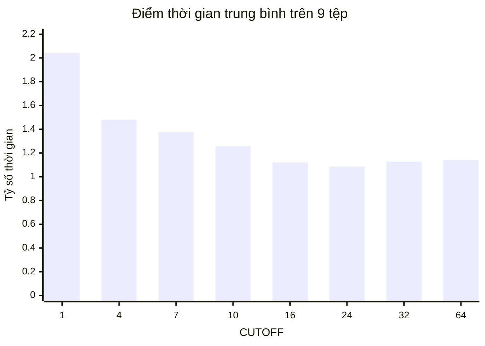

# Thực nghiệm CUTOFF trong Mergesort

## Mục tiêu

Tìm ngưỡng CUTOFF phù hợp với chương trình mergesort trên máy dùng để đo. Khi đoạn mảng có số phần tử nhỏ hơn hoặc bằng CUTOFF, chương trình dùng insertion sort để sắp xếp đoạn đó.

## Thí nghiệm ban đầu

Thí nghiệm dùng Java 21.0.11 trên Windows và thử hai ngưỡng 7 và 10 với cùng một mảng ngẫu nhiên gồm 10.000 số nguyên trong tệp `data/random_10000.txt`. Trước mỗi lượt, chương trình sao chép mảng gốc và tạo mảng phụ. Chương trình dùng `System.nanoTime()` để đo từ lúc gọi hàm sắp xếp đến khi hàm kết thúc. Sau đó, chương trình đối chiếu kết quả với mảng đã được sắp xếp bằng `Arrays.sort`.

Chương trình chạy 10 vòng khởi động rồi ghi kết quả của 10 vòng tiếp theo. Mỗi vòng thử cả hai ngưỡng và đảo thứ tự thử so với vòng trước. Tệp [pilot.csv](results/pilot.csv) lưu 20 số đo theo đơn vị nano giây.

| CUTOFF | Số lượt ghi kết quả | Thời gian trung vị (ms) |
|---:|---:|---:|
| 7 | 10 | 0,54195 |
| 10 | 10 | 0,53115 |

## Nhận xét ban đầu

Trên mảng này, CUTOFF 10 có thời gian trung vị thấp hơn CUTOFF 7 là 0,01080 ms. Lấy CUTOFF 7 làm mốc, mức giảm là (0,54195 − 0,53115) / 0,54195 × 100 ≈ 1,99%. Ở lượt đo đầu CUTOFF 7 nhanh hơn, còn ở lượt thứ hai CUTOFF 10 nhanh hơn. Vì vậy, báo cáo dùng trung vị của cả 10 lượt để so sánh.

## Thí nghiệm chính

[full.csv](results/full.csv) chứa 720 lượt đo trên 9 tệp. Với mỗi tệp, chương trình xáo thứ tự 8 ngưỡng trong từng vòng, khởi động 10 vòng rồi ghi 10 vòng. Mỗi lượt dùng bản sao mới của mảng đầu vào và kiểm tra kết quả sau khi bấm giờ.

Thời gian trung vị (ms), làm tròn đến 5 chữ số thập phân:

| Tệp | 1 | 4 | 7 | 10 | 16 | 24 | 32 | 64 |
|---|---:|---:|---:|---:|---:|---:|---:|---:|
| random_1000.txt | 0.04345 | 0.03090 | 0.03210 | 0.02705 | 0.02170 | 0.02155 | 0.02285 | 0.02360 |
| ascending_1000.txt | 0.01765 | 0.00955 | 0.00935 | 0.00750 | 0.00560 | 0.00560 | 0.00520 | 0.00410 |
| descending_1000.txt | 0.01925 | 0.01150 | 0.01135 | 0.00955 | 0.00920 | 0.00905 | 0.01055 | 0.01495 |
| random_10000.txt | 0.62895 | 0.59405 | 0.54335 | 0.52645 | 0.49755 | 0.47055 | 0.47885 | 0.48340 |
| ascending_10000.txt | 0.17800 | 0.14410 | 0.11930 | 0.11390 | 0.10235 | 0.08845 | 0.08785 | 0.07725 |
| descending_10000.txt | 0.18840 | 0.14495 | 0.13375 | 0.12050 | 0.12535 | 0.12405 | 0.12455 | 0.14475 |
| random_100000.txt | 7.87395 | 7.03360 | 6.72835 | 6.62295 | 6.55500 | 6.22550 | 7.64935 | 6.25115 |
| ascending_100000.txt | 2.04220 | 1.60055 | 1.35025 | 1.40380 | 1.19940 | 1.15410 | 1.14895 | 0.97955 |
| descending_100000.txt | 2.53810 | 2.16110 | 1.99475 | 1.96195 | 1.83045 | 1.93150 | 1.93320 | 2.33185 |

## So sánh và kết luận

Trên mỗi tệp, chia thời gian trung vị của từng ngưỡng cho thời gian trung vị nhỏ nhất. Lấy trung bình 9 tỷ số để mỗi tệp có trọng số bằng nhau. Điểm càng gần 1 càng tốt.

CUTOFF 24 có điểm thấp nhất (1.086), so với 1.376 ở ngưỡng 7 và 1.256 ở ngưỡng 10. Ngưỡng 24 đạt trung vị thấp nhất trên cả ba mảng ngẫu nhiên. Với cả ba mảng tăng dần, ngưỡng 64 nhanh nhất trong các ngưỡng đã thử. Khi mảng đã tăng dần, insertion sort có thể dừng ngay ở lần so sánh đầu tiên của mỗi vòng trong.

Với máy, chương trình và bộ dữ liệu đã thử, đề xuất chọn CUTOFF 24 nếu cần một giá trị chung. Mỗi kích thước dùng một mảng ngẫu nhiên và hai phiên bản sắp thứ tự của mảng đó. Thử thêm seed sẽ giúp kiểm tra độ ổn định của kết quả.
